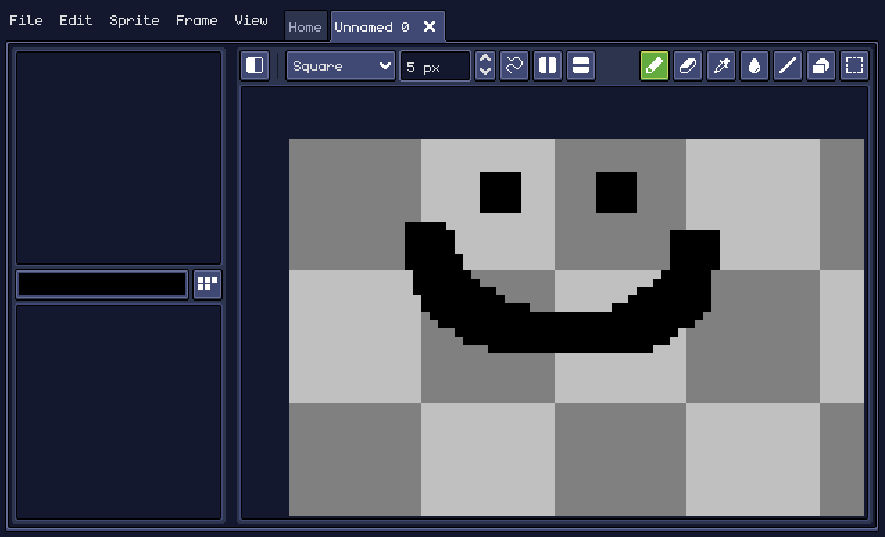
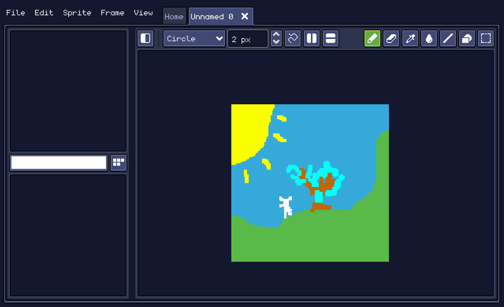
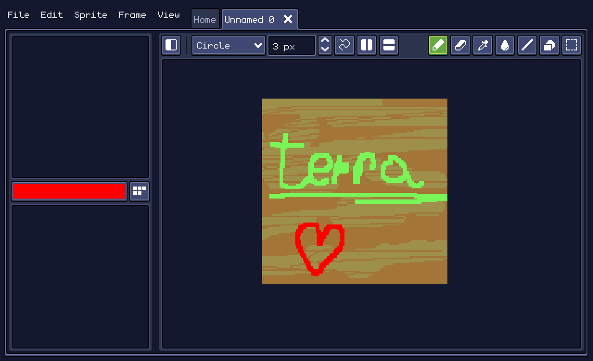

# Pixel Sprite

&nbsp;&nbsp;&nbsp; Pixel Sprite is a drawing and animation software with pixel art, built with the Godot Engine, inspired a lot by Aseprite and optimized for mobile devices with styluses.

  

&nbsp;&nbsp;&nbsp; I always wanted to have a pixel art software for mobile so I can draw while I'm away from my laptop. I tried many different apps on the google play store, and most of them we're bad (from what I've tried). Most we're unintuitive, were filled with ads, required subscription for basic things and they didn't have features I wanted, so that's why I made this app.

&nbsp;&nbsp;&nbsp; I used Aseprite as reference, which is an amazing piece of software, you can see that the UI is pretty similar.

  

>While this software works on desktop, it's not as good as using a program made for desktop!

&nbsp;&nbsp;&nbsp; Using it is not that hard. You create a new file by pressing the "New File" button in home or going to File->New. Choose a canvas resolution and create it! Use the pen tool to draw and the eraser tool to erase. Use the color picker button to choose a color and the brush type and size to change the brush, and that's all there is. Before you start drawing masterpieces, remember that you can't save your work right now!

  

